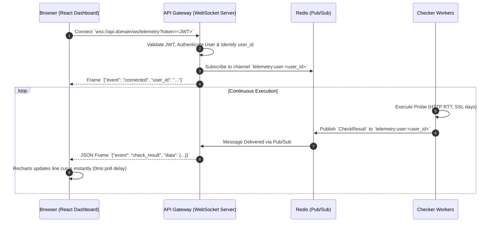

# SPEC-003: Distributed Resilience & Live Telemetry (Milestone 3)

| Metadata             | Description                                                |
| :------------------- | :--------------------------------------------------------- |
| **Spec ID**          | SPEC-003                                                   |
| **Feature Name**     | Multi-Region Quorum Consensus & Live WebSocket Telemetry   |
| **Target Milestone** | Milestone 3 (v0.3.0)                                       |
| **Status**           | `PROPOSED / UNDER REVIEW`                                  |
| **Authors**          | Antigravity AI & System Architect                          |
| **Dependencies**     | Milestone 1 (Core Engine), Milestone 2 (SRE Observability) |

---

## 1. Context & Motivation (Bối Cảnh & Động Lực)

### 1.1 Vấn đề 1: Báo động giả do sự cố mạng cục bộ (False Alarms via Localized Transit Disruptions)

- **Hiện trạng:** Hệ thống checker hiện tại hoạt động theo mô hình tập trung đơn vùng. Khi tuyến cáp quang biển hoặc ISP cục bộ tại nơi đặt worker gặp sự cố (packet loss, routing loop, DNS blackhole), worker báo lỗi kết nối tới máy chủ mục tiêu.
- **Hệ quả:** FSM kích hoạt trạng thái `DOWN`, gửi tin cảnh báo qua Telegram/Discord/Email và trừ sai lệch SLA của người dùng, dù máy chủ của khách hàng tại Mỹ/Châu Âu vẫn đang hoạt động 100% bình thường.
- **Mục tiêu SDD:** Xây dựng cơ chế **Multi-Region Quorum Consensus (Đồng thuận đa vùng)**. Sự cố cục bộ tại 1 vùng không được phép chuyển trạng thái `DOWN` trừ khi được xác nhận chéo bởi đa số ($\ge M/N$) các vùng địa lý độc lập.

### 1.2 Vấn đề 2: Độ trễ và hao phí của cơ chế HTTP Polling trên Dashboard

- **Hiện trạng:** Giao diện React Dashboard phải liên tục gọi API polling định kỳ (10s–15s).
- **Hệ quả:**
  1. Độ trễ hiển thị trạng thái lên tới 10–15 giây kể từ khi sự cố xảy ra.
  2. Gây tải đọc vô ích lên API Gateway và Database PostgreSQL ngay cả khi không có kết quả kiểm tra mới.
- **Mục tiêu SDD:** Xây dựng luồng **Live WebSocket Telemetry Feed** thời gian thực. Bất kỳ kết quả probe hoặc sự kiện chuyển trạng thái nào được ghi nhận sẽ được đẩy thẳng xuống trình duyệt qua kết nối WebSocket hai chiều với độ trễ $< 200\text{ms}$.

---

## 2. System Topology & Architecture (Kiến Trúc & Cấu Trúc Vùng)

```
                       +-----------------------------------+
                       |        Client Web Dashboard       |
                       +-----------------+-----------------+
                                         | WebSocket (WSS)
                                         v
                       +-----------------------------------+
                       |         API Gateway Service       |
                       |  (WebSocket Multiplexer & Auth)   |
                       +-----------------+-----------------+
                                         |
                       +-----------------+-----------------+
                       |       Redis Cluster / Sentinel    |
                       |  - Pub/Sub Channel (telemetry)    |
                       |  - Quorum Sessions (Hash + TTL)   |
                       +-----------------+-----------------+
                                         |
                       +-----------------+-----------------+
                       |    RabbitMQ Topic Exchange        |
                       |      `quorum.exchange`            |
                       +---+-------------+-------------+---+
                           |             |             |
                 Binding:  |             |             |
               *.vn-han    |   *.sg-sin  |    *.us-iad |
                           v             v             v
                     +-----------+ +-----------+ +-----------+
                     | Worker 01 | | Worker 02 | | Worker 03 |
                     | (Hanoi)   | | (Singapore| | (Virginia)|
                     +-----------+ +-----------+ +-----------+
```

### 2.1 Cấu hình Vùng (Region Topology)

Hệ thống chuẩn bị sẵn 3 Region định danh:

1. `vn-han` — Vùng Việt Nam (Hà Nội / VNNIC Transit)
2. `sg-sin` — Vùng Đông Nam Á (Singapore / Equinix SG1)
3. `us-iad` — Vùng Bắc Mỹ (US East / Ashburn Virginia)

### 2.2 Quy tắc Đồng thuận (Quorum Parameters)

- Tổng số vùng tham gia ($N$): $3$ vùng.
- Ngưỡng đồng thuận đa số ($M$): $2$ vùng ($\ge 2/3$ đồng thuận).
- Thời gian chờ đồng thuận (Quorum Challenge Timeout): $15$ giây.

---

## 3. Business Flows & User Journeys (Luồng Nghiệp Vụ)

### 3.1 Flow 1: Kiểm định Đồng thuận Đa vùng khi phát hiện sự cố (Multi-Region Quorum Flow)

```mermaid
sequenceDiagram
    autonumber
    participant W_VN as Worker (vn-han)
    participant RMQ as RabbitMQ (quorum.exchange)
    participant W_SG as Worker (sg-sin)
    participant W_US as Worker (us-iad)
    participant RDS as Redis (Quorum Session)
    participant ALT as Alerter Service

    W_VN->>W_VN: Execute Scheduled Check -> FAILED (HTTP 500 / Timeout)
    W_VN->>RDS: Acquire Quorum Lock `quorum:active:<monitor_id>` (EX 30 NX)
    alt Lock Acquired (First region detecting failure)
        W_VN->>RDS: HSET `quorum:session:<challenge_id>` vn-han=FAIL (EX 60)
        W_VN->>RMQ: Publish Challenge `quorum.challenge` (monitor_id, url, challenge_id)
        RMQ->>W_SG: Deliver Challenge to sg-sin
        RMQ->>W_US: Deliver Challenge to us-iad

        par Out-of-band verification
            W_SG->>W_SG: Probe target URL -> SUCCESS (HTTP 200)
            W_SG->>RDS: HSET `quorum:session:<challenge_id>` sg-sin=PASS
        and
            W_US->>W_US: Probe target URL -> SUCCESS (HTTP 200)
            W_US->>RDS: HSET `quorum:session:<challenge_id>` us-iad=PASS
        end

        W_VN->>RDS: Evaluate Votes from `quorum:session:<challenge_id>`
        alt Majority PASS (1 FAIL, 2 PASS)
            W_VN->>W_VN: Log localized transit failure (vn-han isolated)
            Note over W_VN,ALT: Quorum suppresses alert! State remains UP.
        else Majority FAIL (>= 2 FAIL)
            W_VN->>RMQ: Publish Confirmed Outage to `alert.events`
            RMQ->>ALT: Deliver Confirmed Outage
            ALT->>ALT: Transition FSM to DOWN & Dispatch Notifications
        end
    else Lock Exists (Challenge already in progress)
        W_VN->>RDS: Cast vote vn-han=FAIL into existing `quorum:session:<id>`
    end
```

### 3.2 Flow 2: Live WebSocket Telemetry Feed (Truyền Dữ Liệu Thời Gian Thực)



---

## 4. Technical Contracts & Interface Specifications (Hợp Đồng Kỹ Thuật)

### 4.1 Database DDL Schema Migration (Alembic 003)

Thêm các trường quản lý Quorum vào bảng `monitors` và trường vùng `region_id` vào `check_results`:

```sql
-- Migration 003: Add multi-region quorum support
ALTER TABLE monitors
    ADD COLUMN IF NOT EXISTS quorum_enabled BOOLEAN NOT NULL DEFAULT FALSE,
    ADD COLUMN IF NOT EXISTS quorum_threshold INTEGER NOT NULL DEFAULT 2,
    ADD COLUMN IF NOT EXISTS quorum_regions VARCHAR(32)[] NOT NULL DEFAULT '{"vn-han", "sg-sin", "us-iad"}';

ALTER TABLE check_results
    ADD COLUMN IF NOT EXISTS region_id VARCHAR(32) NOT NULL DEFAULT 'vn-han';

CREATE INDEX IF NOT EXISTS ix_check_results_region_id_created_at
    ON check_results (region_id, created_at);
```

### 4.2 RabbitMQ Topology & Message Schemas

#### Exchange Definition:

- **Tên**: `quorum.exchange`
- **Loại**: `topic`
- **Tính chất**: `durable=True`, `auto_delete=False`

#### Queue & Bindings:

- Queue: `quorum.challenges.vn-han` -> Binding Key: `challenge.vn-han` & `challenge.all`
- Queue: `quorum.challenges.sg-sin` -> Binding Key: `challenge.sg-sin` & `challenge.all`
- Queue: `quorum.challenges.us-iad` -> Binding Key: `challenge.us-iad` & `challenge.all`

#### AMQP Message Contract: `quorum.challenge`

```json
{
  "challenge_id": "c7a8b9d0-1234-5678-abcd-ef0123456789",
  "monitor_id": "9f8e7d6c-5432-10fe-dcba-9876543210ab",
  "initiator_region": "vn-han",
  "url": "https://api.customer.com/health",
  "method": "GET",
  "expected_status_code": 200,
  "timeout_seconds": 5,
  "created_at_utc": "2026-11-04T07:30:00.000000Z"
}
```

### 4.3 Redis Data Structures & TTLs

1. **Quorum Challenge Lock**:
   - Key: `quorum:active:<monitor_id>`
   - Kiểu: `String ("1")`
   - TTL: `30 seconds`
   - Mục đích: Tránh bão kiểm định (challenge storm) khi nhiều worker của cùng 1 vùng đồng loạt báo lỗi.

2. **Quorum Session Voting Hash**:
   - Key: `quorum:session:<challenge_id>`
   - Kiểu: `Hash`
   - Fields: `vn-han`, `sg-sin`, `us-iad`
   - Values: `{"status": "PASS"|"FAIL", "status_code": 200, "rtt_ms": 110}`
   - TTL: `60 seconds`

3. **Telemetry Pub/Sub Channels**:
   - Channel: `telemetry:user:<user_id>` (Dành cho Gateway phân luồng người dùng).
   - Channel: `telemetry:monitors:<monitor_id>` (Dành cho Modal chi tiết).

### 4.4 WebSocket Frame Specification

#### Client to Server (Handshake / Auth):

- URL: `wss://<host>/ws/telemetry?token=<JWT_BEARER_TOKEN>`
- Nếu kết nối không có token trên query params, client gửi frame khởi tạo đầu tiên:

```json
{
  "action": "auth",
  "token": "eyJhbGciOiJIUzI1NiIsInR5cCI6IkpXVCJ9..."
}
```

#### Server to Client: Event Frames

1. **Kết quả kiểm tra thời gian thực (`check_result`)**:

```json
{
  "event": "check_result",
  "timestamp": "2026-11-04T07:30:05.123Z",
  "data": {
    "monitor_id": "9f8e7d6c-5432-10fe-dcba-9876543210ab",
    "region_id": "sg-sin",
    "status_code": 200,
    "response_time_ms": 48,
    "is_success": true,
    "error_message": null,
    "ssl_days_remaining": 88
  }
}
```

2. **Thay đổi trạng thái FSM (`status_change`)**:

```json
{
  "event": "status_change",
  "timestamp": "2026-11-04T07:30:06.000Z",
  "data": {
    "monitor_id": "9f8e7d6c-5432-10fe-dcba-9876543210ab",
    "previous_status": "UP",
    "new_status": "DOWN",
    "reason": "Quorum confirmed outage (2/3 regions failed: vn-han, us-iad)"
  }
}
```

---

## 5. Edge Cases & Resilience Engineering (Xử Lý Biên & Tự Phục Hồi)

| Edge Case                                    | Nguy Cơ                                                                             | Hướng Xử Lý Theo Chuẩn SDD                                                                                                                                                      |
| :------------------------------------------- | :---------------------------------------------------------------------------------- | :------------------------------------------------------------------------------------------------------------------------------------------------------------------------------ |
| **Split-Brain / Region Cô Lập**              | 1 vùng bị ngắt hoàn toàn kết nối với RabbitMQ.                                      | Vùng bị cô lập không thể gửi challenge hoặc nhận kết quả $\rightarrow$ Fallback về quy tắc an toàn: Không đơn phương chuyển trạng thái DOWN nếu `quorum_enabled=True`.          |
| **Challenge Storm**                          | Monitor kiểm tra mỗi 10s liên tục fail, sinh ra hàng trăm challenge dồn ứ hàng đợi. | Khóa atomic Redis `SET quorum:active:<monitor_id> 1 EX 30 NX`. Nếu đang có 1 challenge đang giải quyết trong 30s qua, bỏ qua không phát sinh thêm challenge mới.                |
| **Timeout Vùng Chậm (Slow Region)**          | 1 vùng mất tới 20s không trả lời vote.                                              | Sử dụng `asyncio.wait_for(..., timeout=15.0)`. Nếu quá 15s vùng đó không ghi vote vào Redis Hash, tính là `ABSTAIN` (bỏ phiếu trắng). Đánh giá quorum dựa trên số vùng còn lại. |
| **WebSocket Slow Consumer / Disconnect**     | Client mạng 3G/4G chập chờn, buffer websocket bị đầy làm treo worker Gateway.       | Gateway dùng `asyncio.Queue(maxsize=100)`. Khi buffer đầy, drop frame cũ nhất (`drop_oldest`) và ngắt kết nối client sau 3 lần retry thất bại.                                  |
| **JWT Token Hết Hạn Khi Đang Giữ WebSocket** | Client mở tab qua đêm, token 24h hết hạn.                                           | Gateway kiểm tra TTL của JWT. Trước khi hết hạn 5 phút, gửi frame `{"event": "token_expiring"}` yêu cầu Dashboard làm mới token ngầm qua refresh API.                           |

---

## 6. Acceptance Criteria (Tiêu Chí Nghiệm Thu BDD - Given/When/Then)

### AC-01: Chặn đứng báo động giả do mạng cục bộ

- **Given**: Monitor `M1` có cấu hình `quorum_enabled=True`, `quorum_threshold=2`.
- **When**: Worker `vn-han` phát hiện HTTP 500 do lỗi peering, nhưng `sg-sin` và `us-iad` phản hồi HTTP 200.
- **Then**: Trạng thái `M1` vẫn giữ là `UP`. Không có bất kỳ cảnh báo Telegram/Email nào được gửi đi. Ghi nhận log cảnh báo peering cục bộ tại `vn-han`.

### AC-02: Đồng thuận chuyển trạng thái DOWN khi sự cố thật

- **Given**: Monitor `M1` có `quorum_enabled=True`, `quorum_threshold=2`.
- **When**: Worker `vn-han` phát hiện timeout, phát sinh challenge, và worker `sg-sin` cũng trả về kết quả timeout (2/3 vùng xác nhận fail).
- **Then**: Quorum đạt tỷ lệ đồng thuận đa số $\rightarrow$ FSM chuyển trạng thái `DOWN` $\rightarrow$ Gửi cảnh báo đính kèm bằng chứng xác nhận từ 2 vùng.

### AC-03: Đẩy dữ liệu WebSocket tức thời (Real-time Latency Update)

- **Given**: Người dùng đang mở Dashboard trên trình duyệt có kết nối WebSocket authenticated.
- **When**: Worker thực thi xong một lần probe và lưu DB.
- **Then**: Trình duyệt nhận được frame `check_result` trong vòng $<200\text{ms}$. Biểu đồ độ trễ tự động append điểm dữ liệu mới mà không cần F5 hay chạy HTTP Polling.

### AC-04: Tự động kết nối lại WebSocket với Exponential Backoff

- **Given**: Trình duyệt bị mất mạng đột ngột trong 5 giây.
- **When**: Mạng Internet phục hồi.
- **Then**: Dashboard tự động thực hiện reconnect theo thuật toán exponential backoff (`1s`, `2s`, `4s`, tối đa `10s`), tự động xác thực lại mà không bắt người dùng đăng nhập lại.

---

## 7. Phased Implementation Plan (Kế Hoạch Thực Hiện Theo Pha)

```
[Phase 1: DB Migration & Contracts]
  ├── alembic/versions/003_multi_region_quorum.py
  ├── services/common/schemas.py (DTOs cho Quorum & WebSocket)
  └── services/common/models.py (Cập nhật Model Monitor & CheckResult)

[Phase 2: Regional Worker & AMQP Challenge Exchange]
  ├── services/checker/checker.py (Gắn region_id, logic dispatch challenge)
  ├── services/checker/quorum_consumer.py (Consumer xử lý verification out-of-band)
  └── docker/docker-compose.prod.yml (Tách 3 worker instance với biến môi trường REGION_ID)

[Phase 3: Redis Quorum Aggregator & Alerter Decision]
  ├── services/alerter/quorum_engine.py (Bộ thu thập vote & đánh giá đa số)
  └── tests/test_quorum_consensus.py (Bộ test giả lập mạng phân vùng)

[Phase 4: Live WebSocket Gateway & React Dashboard Streaming]
  ├── services/api_gateway/routers/websocket.py (Endpoint /ws/telemetry & ConnectionManager)
  ├── services/dashboard/src/api/websocket.ts (Client hook useWebSocketTelemetry)
  └── tests/test_websocket_telemetry.py (Test xác thực & broadcast frame)
```
